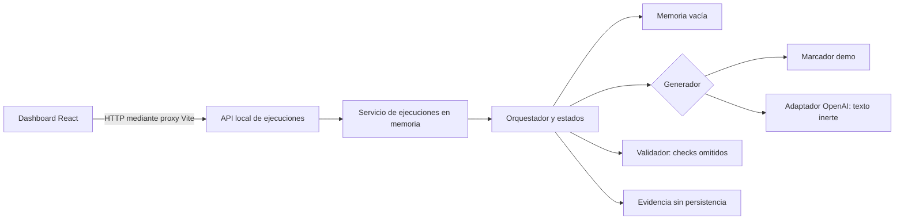

# BuildSys — Plataforma Multiagente de Generación de Software

**BuildSys** es el nombre del proyecto presentado en el RSI Hackathon de OpenAI / Kavak el **9 de noviembre de 2026**. **BuildSec** es el nombre actual de este repositorio y aparece en rutas, identificadores y mensajes del prototipo. El resultado presentado fue una simulación demostrable, no un producto terminado.

## Descripción

BuildSys explora cómo coordinar componentes especializados para transformar requisitos expresados en lenguaje natural en software. La propuesta contempla planificar, generar código, ejecutar pruebas, corregir fallos y reutilizar soluciones verificadas. Su diferenciador conceptual es conservar conocimiento útil para ejecuciones posteriores, sin depender necesariamente del reentrenamiento de los modelos.

El prototipo implementa partes de ese flujo, pero **no genera ni valida de forma autónoma aplicaciones funcionales de extremo a extremo**. En particular, la validación de artefactos y la memoria reutilizable todavía no están integradas.

## Problema y propuesta

Desarrollar software a partir de requisitos implica coordinar tareas distintas: comprender la solicitud, producir una solución, comprobarla y aprender de los resultados. BuildSys propone organizar estas responsabilidades mediante agentes o componentes especializados coordinados por un orquestador. En el repositorio actual son módulos y adaptadores de un backend modular, no microservicios independientes.

El flujo objetivo comprende planificación, generación, validación, corrección y aprendizaje reutilizable. Hoy el orquestador registra transiciones y coordina puertos; no existe un planificador ni un analizador de riesgos funcionales. El bucle puede volver a invocar al generador con resultados previos, pero no garantiza una corrección real. La recuperación y promoción de Golden Routes son interfaces, no una memoria operativa.

## Arquitectura y funcionamiento

El siguiente diagrama muestra las conexiones del runtime actual. Las etiquetas **demo**, **omitido** y **vacía** describen adaptadores provisionales; no implican servicios independientes.



1. El dashboard envía un objetivo y checks requeridos a la API. El servicio crea una ejecución y publica instantáneas de sus estados.
2. El orquestador consulta el puerto de memoria y recorre los estados de planificación, riesgo, generación y validación. Las etapas de planificación y riesgo son transiciones, no análisis implementados.
3. En modo demo, el generador devuelve un marcador; en modo OpenAI puede solicitar texto fuente al proveedor. El texto no se escribe ni se ejecuta en el workspace y la API no ofrece un endpoint para recuperarlo.
4. El validador del runtime devuelve `skipped` para los checks requeridos. La composición OpenAI también los omite porque el contrato v1 no entrega el artefacto al validador. Por ello, si no hay un bloqueo previo, la ejecución termina en `FAILED` al agotar sus intentos.
5. El bucle admite feedback y reintentos limitados. El almacén de evidencia del runtime no persiste datos ni genera referencias y la memoria está vacía; el aprendizaje reutilizable permanece pendiente.

Un check `skipped` no cuenta como aprobado. `COMPLETED` exige un resultado `passed` único para cada check obligatorio. Las pruebas con dobles verifican este comportamiento, pero no prueban que se haya validado un artefacto generado.

## Componentes técnicos

| Componente | Responsabilidad actual |
|---|---|
| `src/core/orchestrator.py` | Coordina adaptadores, transiciones, intentos, feedback y plazos. |
| `src/core/models.py` | Define objetivo, ejecución, estados y resultados de validación. |
| `src/core/adapters.py` | Declara los puertos de generación, validación, evidencia y memoria. |
| `src/generation/openai_generator.py` | Usa el SDK oficial de OpenAI para solicitar texto inerte; no lo materializa ni ejecuta. |
| `src/core/composition.py` y `src/core/openai_*.py` | Componen el servicio, validan configuración y cargan credenciales para el cliente backend. |
| `src/api/` | Expone una API HTTP local, ejecuciones síncronas y asíncronas, historial volátil y capacidades del runtime. |
| `frontend/` | Dashboard React, TypeScript, Vite y Tailwind: formulario, estados, historial, resultados y polling. Incluye un ejemplo local identificado como simulado. |
| `tests/` y `frontend/tests/` | Pruebas de backend y frontend, con dobles para adaptadores y proveedor. |
| `scripts/goal_loop.py` y `config/checks.json` | Runner separado para tareas Codex y checks de un checkout confiable; no implementa el sandbox de la aplicación ni realiza operaciones Git. |

## Estado de implementación

| Capacidad | Estado | Alcance verificado en el código |
|---|---|---|
| Orquestación | **Parcial** | Máquina de estados, coordinación de puertos, feedback y reintentos acotados; planificación y análisis de riesgos son etapas sin implementación propia. |
| Generación | **Parcial** | Marcador demo o adaptador OpenAI que devuelve texto inerte; la API no entrega el código generado. |
| Validación | **Simulada / pendiente** | El runtime omite los checks; falta traspasar y validar el artefacto generado. |
| Corrección | **Parcial** | Existe un bucle de reintento con feedback, sin corrección automática verificada de código. |
| Memoria reutilizable | **Pendiente** | Hay interfaz de memoria y Golden Routes, pero el runtime usa memoria vacía. |
| Persistencia de evidencias | **Pendiente** | Hay interfaz de evidencia; el runtime no guarda registros persistentes. |
| Interfaz de demostración | **Parcial** | Dashboard conectado a la API y ejemplo local simulado; el historial se pierde al reiniciar. |
| Controles de seguridad | **Parcial / propuesto** | Hay medidas locales como loopback, límites y sanitización; no hay un motor de controles ISO implementado. |

## Seguridad

El diseño contempla ISO/IEC 27001:2022 como referencia de prácticas, entre ellas:

- **A.8.25** — Ciclo de vida de desarrollo seguro.
- **A.8.26** — Requisitos de seguridad de aplicaciones.
- **A.8.28** — Codificación segura.
- **A.8.29** — Pruebas de seguridad durante desarrollo y aceptación.

Estas referencias no representan certificación ni una declaración de conformidad. No se ha demostrado la implementación completa de esos controles. Las comprobaciones locales existentes no equivalen a un análisis de riesgos, escaneo de dependencias, detección de secretos o validación de seguridad del software generado.

La API está destinada a uso local y escucha en `127.0.0.1`; no tiene autenticación. El código generado no se ejecuta desde la aplicación. **No ejecutes código generado o no confiable en el host**: hace falta un sandbox real, aislado y con límites, que aún no está integrado. `config/checks.sandbox.example.json` es solo una plantilla de runner que requiere revisión y adaptación, no una garantía de aislamiento.

## Ejecución local

### Requisitos

- Python 3.11 o posterior, `uv`, Node.js y npm. El entorno opcional de [Nix](flake.nix) proporciona Python 3.12, `uv`, Node.js 22 y Git mediante `nix develop`.
- Dependencias de Python indicadas en [requirements.txt](requirements.txt) y dependencias frontend fijadas por `frontend/package-lock.json`. La instalación necesita acceso a los registros correspondientes.
- Para OpenAI: un modelo accesible y credenciales configuradas en el backend. La configuración no demuestra que el proveedor vaya a aceptarlas.

Desde la raíz del repositorio:

```bash
# Opcional, si utilizas Nix
nix develop

# Prepara .venv e instala dependencias backend y frontend
./scripts/init.sh

# Inicia backend demo y dashboard
./scripts/run.sh demo
```

Por defecto, la API escucha en `http://127.0.0.1:8000` y Vite en `http://127.0.0.1:5173`. `Ctrl+C` solicita el cierre de los procesos iniciados. Si los puertos están ocupados, el script informa el problema; también admite `BUILDSEC_BACKEND_PORT` y `BUILDSEC_FRONTEND_PORT` para elegir otros puertos.

**Modo demo:** no llama al proveedor y no produce código. Los checks se omiten y no hay evidencia persistente. El botón de ejemplo local del dashboard muestra datos simulados separados de las ejecuciones del backend.

**Modo OpenAI:** configura `OPENAI_MODEL` en el entorno y las credenciales siguiendo [README-SECRETS.md](README-SECRETS.md), sin publicarlas ni incluirlas en el frontend. Una variable `OPENAI_API_KEY` no vacía tiene precedencia sobre el archivo local ignorado. Después ejecuta:

```bash
export OPENAI_MODEL="<modelo-disponible-en-tu-proyecto>"
./scripts/run.sh openai
```

Este modo puede enviar solicitudes reales al proveedor y generar costos. El resultado sigue siendo texto inerte: los checks requeridos se omiten, y no se dispone de artefactos ni evidencia persistente a través de la API. Los errores de configuración y proveedor se muestran de forma sanitizada. La disponibilidad del backend no garantiza autenticación ni disponibilidad del proveedor.

### Verificación

Con las dependencias instaladas:

```bash
.venv/bin/python -m unittest discover -v
cd frontend
npm run lint
npm run build
npm test
```

Para comprobar el flujo demo con servicios propios y puertos temporales, desde la raíz:

```bash
.venv/bin/python scripts/smoke_demo.py
```

Las pruebas HTTP necesitan poder abrir sockets locales. El smoke test cubre el modo demo, no una llamada real a OpenAI ni validación de código generado.

## Limitaciones actuales

- No hay ArtifactStore ni traspaso seguro del resultado generado al validador; la validación funcional y de seguridad de artefactos está pendiente.
- No hay sandbox real integrado, ejecución aislada del código generado ni garantía de terminación efectiva de adaptadores. Un timeout no detiene un hilo que ya está ejecutándose y puede prolongar el cierre.
- No hay memoria reutilizable operativa, promoción de Golden Routes ni persistencia de evidencias. Las referencias de evidencia que pudiera devolver un adaptador no prueban por sí mismas la existencia de un archivo verificado.
- Las ejecuciones viven en memoria, se pierden al reiniciar y no existe cancelación mediante la API. El dashboard no recupera el código generado.
- La API no tiene autenticación y está prevista únicamente para uso local. La configuración y aceptación de credenciales OpenAI dependen del entorno y del proveedor.
- El [contrato v2 de artefactos y validación](src/core/ARTIFACT_VALIDATION_V2_DRAFT.md) es una propuesta pendiente de revisión y aprobación conjunta; [CONTRACTS.md](CONTRACTS.md) conserva el contrato v1.

## Demostración visual

El repositorio no incluye capturas de la interfaz. Para una futura sección de demostración conviene incorporar capturas reales del dashboard con el indicador de backend demo, una ejecución terminada con checks `skipped` y el mensaje de resultados no disponibles. Cada imagen debe identificar su modo y no presentarse como evidencia de generación, validación o aprendizaje de extremo a extremo.

## Documentación adicional

- [API de ejecuciones y runtime](src/api/EXECUTIONS.md).
- [Composición y límites del generador](src/core/GENERATION.md).
- [Dashboard y pruebas frontend](frontend/README.md).
- [Contratos v1](CONTRACTS.md) y [propuesta de artefactos y validación](src/core/ARTIFACT_VALIDATION_PROPOSAL.md).
- [Tareas y división de trabajo](TASKS.md), [instrucciones para agentes](AGENTS.md) y [gobernanza Git vigente](.agents/skills/git-governance/SKILL.md).
- [Adaptación histórica de la gobernanza](docs/GIT-ADAPTATION.md) y `prompts/` con materiales de coordinación y objetivos de demo; no describen por sí solos capacidades ya implementadas.
